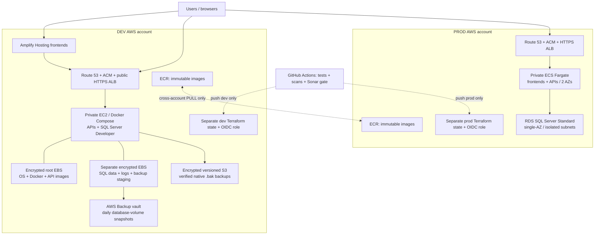

# Agrovesto AWS Infrastructure

Terraform infrastructure for **two separate AWS accounts**:

- **`dev`** — Amplify Hosting frontends; private EC2 running Docker Compose APIs and **Microsoft SQL Server Developer edition**. OS, Docker and APIs share the root disk; SQL data, logs and backup staging use a **second, encrypted EBS disk**.
- **`prod`** — frontends **and** APIs on private ECS Fargate; **Amazon RDS for Microsoft SQL Server Standard**, license included, **single-AZ**. Each API has its own database and runtime login.

Both environments include ECR, Route 53, ACM HTTPS certificates, CloudWatch, budgets, alerts, CloudTrail, GuardDuty and protected storage. No MySQL resources are used.

> **This is a configurable infrastructure foundation, not an already deployed platform.** Create the accounts, register a domain, bootstrap state/OIDC, configure SonarQube and supply real application images before enabling services. Examples contain deliberately fictitious IDs and image digests. Terraform does not create AWS Organizations/accounts, register domain names, host SonarQube, or invent your application code.

## Activate the workflow locally

The workflow is supplied as **[`infrastructure.yml`](infrastructure.yml) in the repository root**, as requested. It is **inactive** there: GitHub will not run its PR checks or deployments until you move and commit it into the workflow directory using an account authorized to update workflows:

```bash
mkdir -p .github/workflows
git mv infrastructure.yml .github/workflows/infrastructure.yml
git commit -m "ci: activate infrastructure workflow"
```

Push that change from your local checkout and complete the GitHub/Sonar setup below before relying on CI or enabling services. **Use exactly this destination filename**: the AWS OIDC trust already pins `.github/workflows/infrastructure.yml` and must not be changed to the inactive root path. Local unit tests and `make checkov` support either location; the scanner stages a temporary copy for analysis without activating it.

## Contents

1. [Architecture](#architecture)
2. [Repository layout](#repository-layout)
3. [Security and deployment model](#security-and-deployment-model)
4. [Prerequisites](#prerequisites)
5. [First deployment](#first-deployment)
6. [Adding applications](#adding-applications)
7. [Database connections and administration](#database-connections-and-administration)
8. [Backups and monitoring](#backups-and-monitoring)
9. [Costs and limitations](#costs-and-limitations)
10. [Local checks](#local-checks)
11. [Operations and further reading](#operations-and-further-reading)

## Architecture



| Concern | Dev | Prod |
|---|---|---|
| Frontends | Configurable Amplify apps/branches, static Hosting ZIP deployment, optional custom domains | ECS services, including containerized SSR frontends |
| APIs | Docker Compose on one private x86-64 EC2 host | Fargate, at least two tasks per enabled service, autoscaling and rollback |
| SQL engine | SQL Server 2022 Developer in Linux Docker; **non-production only** | RDS `sqlserver-se`, SQL Server 2022, `license-included`, **single-AZ** |
| Per-API isolation | A database and login for each `databases` entry | Same database/login model; frontend tasks have no DB access |
| Disks | 50 GiB encrypted OS/Docker root + independent 100 GiB encrypted gp3 SQL volume by default | Encrypted gp3 RDS storage, autoscaling ceiling; encrypted Fargate ephemeral storage |
| Backups | Daily native `.bak` to S3 **and** daily EBS snapshots, 35-day retention | RDS automatic backups/PITR, 35 days; native S3 backup/restore option configured for on-demand use |
| Network | Two-AZ VPC, one NAT; EC2 in first private app subnet | Two-AZ VPC, one NAT per AZ; private tasks and isolated DB subnets |
| Internet ingress | ALB 443; port 80 redirects only. No public IP/SSH/SQL port on EC2 | ALB 443 (no WAF). No public IPs on tasks/RDS |
| Images | KMS-encrypted immutable ECR, scan on push, peer account pull policy | Same; production service images **must use digests** |
| Observability | Host CPU/memory/both disks/status, container logs, backup heartbeat, API health | ECS/ALB health, RDS CPU/storage/memory/events, Container Insights |
| Governance | Dedicated state, permissions boundary, CloudTrail, GuardDuty, SNS, budget | Same, with a separate account, key, state, role and protected GitHub environment |

There is **no VPC peering or cross-account database access**. ECR sharing is repository-level read access, not shared infrastructure state, shared credentials, replication, or permission to push into the other account.

## Repository layout

```text
bootstrap/{dev,prod}/      # Human-admin bootstrap: state, OIDC, IAM boundary, optional new DNS zone
modules/
  account_bootstrap/      # Per-account bootstrap resources and exact OIDC trust
  storage/               # Private/versioned/TLS-only S3, encryption, retention, optional Object Lock
  foundation/            # KMS, audit/access logs, CloudTrail, GuardDuty, SNS and account budget
  network/               # Public/app/isolated subnets, NAT, S3 endpoint and VPC flow logs
  dns/                   # Create/reference/import public zones and records; ACM validation
  edge/                  # ALB, HTTPS redirect, TLS policy (no WAF)
  ecr/                   # Encrypted repositories, immutable tags, cross-account pull policies
  amplify/               # Dev static frontend Hosting apps, branches and domains
  sql_secrets/           # Per-database secret metadata; no passwords in state
  dev_host/              # EC2, independent DB disk, versioned configuration, SSM, backups
  ecs/                   # Per-service Fargate tasks/roles/routing/scaling; private SQL admin task
  rds_sqlserver/         # Private single-AZ SQL Server Standard, native restore and monitoring
  .../versions.tf        # All modules use the same exact provider version

environments/{dev,prod}/  # Independent deployable Terraform roots + examples + mock plan tests
scripts/database.py       # Safe SQL provisioning, dev secret files and verified native backups
scripts/dev/              # Fail-closed disk mounting, Compose startup and systemd backup timer
scripts/ci/               # Branch/account validation, Terraform checks, saved-plan protection
scripts/run-sql-admin.sh  # One-off private production DB initialization (operator action)
scripts/publish-amplify.sh
ops/sql-admin/            # Container build for the production SQL administration program
compose/                  # Reference + local Docker Compose (dev host Compose is Terraform-rendered)
apps/                     # Sample api/web Dockerfiles meeting the platform image contract
tests/                    # Offline Python, repository and workflow tests + shared AWS mocks
docs/                     # Detailed setup, DNS, security and recovery runbooks
infrastructure.yml        # Inactive workflow; move locally to .github/workflows/infrastructure.yml
```

There are **four independent Terraform states**, not workspaces: two bootstrap states and two environment states. Bootstrap starts locally and is migrated to its account's encrypted S3 bucket. Environment backends use S3 native lock files; no DynamoDB table is needed. Do not use non-default workspaces.

## Security and deployment model

The following CI behavior applies **after manual workflow activation** above.

- AWS credentials in GitHub are **short-lived OIDC sessions**, not access keys.
- Role trust matches the **repository, environment, exact branch, `push` event, and workflow path**. It uses a required custom GitHub OIDC subject template. See [GitHub setup](docs/github-actions.md).
- A push to `dev` can deploy **only the dev root/account**. A push to `prod` can deploy **only the prod root/account**. Other branches/tags, PRs, schedules and manual dispatches cannot deploy through this workflow.
- PRs run unit tests, ShellCheck, Terraform formatting/validation/provider-mocked plans, Checkov, Trivy source/image scans and Sonar analysis for trusted same-repository PRs. **No PR job receives AWS credentials or connects to state.** Forks run secret-free checks but the final gate blocks until a reviewed same-repository PR can run Sonar.
- Missing Sonar configuration, a failed scan, or a skipped required job **blocks deployment**. The Sonar server needs branch/PR analysis support and a reachable HTTPS endpoint.
- The deploy job creates a saved plan, checks for protected-data deletion and known insecure settings, and applies **that exact plan**. State/plans are never uploaded as GitHub artifacts.
- AWS provider, backend, OIDC role and CI configuration all check the target account. CI cannot change its own bootstrap role/boundary, delete the backend, or read bootstrap state.
- Terraform provisions Secrets Manager **metadata**, not generated password values. Dev generates credentials on the host; RDS manages its master secret; the private admin task generates API login secrets. Application roles never receive the admin secret.

The provisioning role is intentionally powerful within the listed infrastructure services. It is **not a universal least-privilege role**: use dedicated accounts, reviewed changes, GitHub branch/environment protections and the supplied workload boundary. [Read the security trade-offs and scanner exceptions](docs/security.md) before going live.

## Prerequisites

1. Two AWS accounts you control, with different IDs. Use AWS Organizations/Control Tower where appropriate; enable root MFA, restrict root use and configure IAM Identity Center/SSO for operators. Account creation and billing ownership are outside this repository.
2. An owned domain at a registrar. Public DNS must be delegated before ACM/Amplify can validate it. Examples use `example.com` and `dev.example.com`; **replace them**.
3. A region supporting Amplify and RDS SQL Server with two available AZs. The example is `eu-west-1`; adjust **both region and AZs** together. Verify RDS engine/class availability and service quotas in the target account.
4. Terraform **1.11.4** (CI pin; code requires >=1.11), AWS CLI v2, Python 3.12, Git, `jq`, and Docker for image builds. Terraform AWS provider **6.11.0** is pinned in all roots/modules, with committed lock files.
5. GitHub repository administration access to configure environments, branch rules, OIDC subject customization and the Sonar secret. Use the existing GitHub connection/CLI; do not put credentials in chat or Git.
6. Self-hosted SonarQube with a project, quality gate and branch/PR analysis capability (normally Developer edition or higher). Its server/integration is **not** provisioned into either application account.
7. SQL Server EULA acceptance for dev. Developer edition cannot serve live production traffic. RDS license-included charges are a material production cost.

## First deployment

### 1. Configure and bootstrap both accounts

Copy and edit the examples. These local files are ignored by Git.

```bash
cp bootstrap/dev/terraform.tfvars.example bootstrap/dev/terraform.tfvars
cp bootstrap/prod/terraform.tfvars.example bootstrap/prod/terraform.tfvars
```

Set real account IDs. For **new** DNS zones, set `bootstrap_zone_name` to `dev.your-domain` in dev and `your-domain` in prod. This creates zones during the human bootstrap, giving you their nameservers **before** an environment needs an HTTPS certificate. For existing DNS, leave it null and follow [reference/import instructions](docs/dns.md).

Using your authorized SSO profiles, bootstrap each account separately. These are the only normal, human-run Terraform **applies** in the setup procedure; environment applies run through the gated workflow.

```bash
aws sso login --profile agrovesto-dev
AWS_PROFILE=agrovesto-dev terraform -chdir=bootstrap/dev init
AWS_PROFILE=agrovesto-dev terraform -chdir=bootstrap/dev plan -out=bootstrap.tfplan
AWS_PROFILE=agrovesto-dev terraform -chdir=bootstrap/dev apply bootstrap.tfplan

# Export these BEFORE adding the S3 backend block.
AWS_PROFILE=agrovesto-dev terraform -chdir=bootstrap/dev output -raw bootstrap_backend_hcl > bootstrap/dev/backend.hcl
AWS_PROFILE=agrovesto-dev terraform -chdir=bootstrap/dev output -raw environment_backend_hcl > environments/dev/backend.hcl
cp bootstrap/backend.tf.example bootstrap/dev/backend.tf
AWS_PROFILE=agrovesto-dev terraform -chdir=bootstrap/dev init -migrate-state -backend-config=backend.hcl
```

Repeat for `prod`, using `agrovesto-prod-admin` and **only** the `bootstrap/prod` directory. Do not change the account of an initialized root or copy one account's state into the other. Confirm state migration before securely removing local state/plan backups; **never commit them**. The generated bootstrap backend block is deliberately ignored by Git.

Record each bootstrap's outputs: deployment role ARN, state bucket/KMS key, workload boundary ARN, and (if created) DNS zone ID/nameservers. Bootstrap needs sufficient operator privileges to create IAM, KMS, S3 and optionally Route 53; GitHub cannot bootstrap its own authority.

### 2. Prepare DNS and environment inputs

```bash
cp environments/dev/terraform.tfvars.example environments/dev/terraform.tfvars
cp environments/prod/terraform.tfvars.example environments/prod/terraform.tfvars
```

Edit account IDs, peer IDs, region/AZs, zone names, alert emails and the exact bootstrap boundary ARNs. If bootstrap owns the zone, set `existing_zone_id` to its output; **do not import it into a second state**.

At the registrar, set the root domain's authoritative nameservers to the prod zone's four nameservers. Add a `dev` NS delegation in the prod zone to the dev zone's **actual four nameservers**. This NS record can be in prod `dns_records` on its first deployment; start prod before dev, or have the DNS administrator create it and import the record. [DNS ownership/import examples](docs/dns.md) explain both paths.

Leave `services_enabled = false` for initial scaffolding. WAF is not used; RDS is single-AZ. Set `accept_sqlserver_eula = true` in dev **only after acceptance**. Initially `sql_admin_image = null` is allowed in prod, but it is only a placeholder task definition and is not runnable yet.

### 3. Configure GitHub and SonarQube

Follow [docs/github-actions.md](docs/github-actions.md) **before the first deployment push**:

- Move `infrastructure.yml` to `.github/workflows/infrastructure.yml` locally and commit/push it with workflow-authorized access.
- Exact `dev`/`prod` deployment branches and protected GitHub environments.
- OIDC subject template: `repo`, `context`, `ref`, `event_name`, `workflow_ref`.
- Environment variables: `AWS_ACCOUNT_ID`, `AWS_REGION`, `AWS_ROLE_ARN`, `TF_STATE_BUCKET`, `TF_STATE_KMS_KEY_ARN`, `TF_VARS_JSON`.
- Repository variables `SONAR_HOST_URL`, `SONAR_PROJECT_KEY`; repository secret `SONAR_TOKEN`.
- Required `All required checks` status, code-owner approvals and production reviewers.

Convert your non-secret HCL inputs to JSON if convenient:

```bash
python3 -m venv .venv
. .venv/bin/activate
pip3 install -r requirements-dev.txt
python scripts/tfvars-to-json.py environments/dev/terraform.tfvars > /tmp/dev-inputs.json
gh variable set TF_VARS_JSON --env dev --body "$(cat /tmp/dev-inputs.json)"
rm /tmp/dev-inputs.json
```

Repeat for prod. Terraform values are configuration, not credentials. Never put passwords, signing keys or private tokens in `TF_VARS_JSON`, frontend variables, plain task environments or user data.

### 4. Push reviewed configuration to the environment branch

Have the repository administrator establish the real `dev` and `prod` branches with this implementation. Merge a reviewed PR into the appropriate branch. Its resulting **push** runs the same checks again and deploys only that account. There is no apply button or `workflow_dispatch` backdoor.

First creation is not instant: RDS SQL Server may take tens of minutes, and DNS validation may wait for propagation. The role allows a two-hour session; RDS creation has a 90-minute timeout. Confirm DNS first and inspect the workflow/CloudWatch rather than starting concurrent applies.

### 5. Publish images, initialize SQL, then enable applications

**Dev:** the host mounts the DB volume by EBS volume ID, generates `sa`/API credentials, starts SQL Server and creates configured databases/logins even while APIs are disabled. SSM configuration success is awaited by Terraform. Publish real API images into ECR, update image references, then set `services_enabled = true` for a reviewed dev push. Build each static frontend ZIP and publish it with `scripts/publish-amplify.sh APP_ID dev build.zip` using an authorized frontend publisher/operator session.

**Prod:** after scaffold creates ECR, build, scan and push the admin image using a separate trusted image-publisher role or an authorized SSO session:

```bash
REGION=eu-west-1
REGISTRY=222222222222.dkr.ecr.eu-west-1.amazonaws.com # replace
TAG=reviewed-commit-sha                            # replace; immutable
aws ecr get-login-password --region "$REGION" | docker login --username AWS --password-stdin "$REGISTRY"
docker build --pull --platform linux/amd64 -f ops/sql-admin/Dockerfile -t "$REGISTRY/agrovesto/sql-admin:$TAG" .
trivy image --config trivy.yaml "$REGISTRY/agrovesto/sql-admin:$TAG"
docker push "$REGISTRY/agrovesto/sql-admin:$TAG"
aws ecr describe-images --repository-name agrovesto/sql-admin --image-ids imageTag="$TAG" \
  --query 'imageDetails[0].imageDigest' --output text
```

Use the returned digest in `sql_admin_image`, keep services disabled, and push the reviewed change to prod. Initialize your local **prod backend** with the bootstrap output and the matching operator session, then run:

```bash
AWS_PROFILE=agrovesto-prod-admin terraform -chdir=environments/prod init -backend-config=backend.hcl
AWS_PROFILE=agrovesto-prod-admin scripts/run-sql-admin.sh
```

The script verifies the account, runs the private admin task, waits for its exit, and requires exit code zero. It creates databases/logins, **not your application tables**. Run application-specific schema migrations with controlled migration privileges. Publish/scan actual API and frontend images, replace every example digest, then set `services_enabled = true` for the next reviewed prod push.

The infrastructure workflow deliberately does **not** build/push application images, run schema migrations, or execute privileged SQL automatically. Those require application code, release tests and an explicit migration/rollback policy. Trivy does build/scan the SQL admin image in CI without pushing it.

## Adding applications

1. Add a stable database key/name to `databases` if the API needs one; never use system DB names or the reserved `admin` key.
2. Add an image repository suffix to `ecr_repositories` in **both** accounts where it should exist. Matching repository names make image promotion simpler.
3. Add a `services` entry. Set image, container port, hostname and unique ALB priority; dev also requires a unique `host_port`. Set `database_key` only on DB-backed APIs.
4. Implement the ALB health path. It must report readiness without authentication, not return redirects/403, and must not disclose sensitive diagnostics. Optional ECS `health_check_command` must be supported by the actual image.
5. Images must run on Linux x86-64, bind `0.0.0.0` on the configured unprivileged port, support a non-root UID and a read-only root filesystem. Dev provides writable `/tmp` tmpfs. **Production images needing writable cache/temp paths need a deliberately designed ephemeral volume/mount extension; do not silently turn off the plan guard.**
6. Supply non-secret values through `environment`; use same-account Secrets Manager ARN references through `secrets`. Encrypt those extra secrets with the environment key unless you deliberately extend KMS permissions. Do not override reserved injected `DB_*` names.
7. Provision the new login/database, run its schema migrations, then enable/redeploy the service. Removing a database map entry is blocked by `prevent_destroy`; it never silently drops a database.

`hostname = ""` serves the zone apex; `hostname = "api"` serves `api.<zone>`. Names must be single labels because the certificate covers the apex and one-level wildcard. Health ports, listener priorities, duplicate hostnames and Fargate CPU/memory pairs are validated.

For dev frontends, add entries to `frontends`. `domain_prefix = null` uses only the Amplify-provided URL; otherwise use a unique prefix. The supplied Amplify module is **static/manual Hosting** (`WEB`), with no GitHub token in state. Git-connected builds or Amplify SSR (`WEB_COMPUTE`) need an appropriate GitHub App/Console connection, build role/configuration and an intentional module extension/import. Production frontends already run on ECS. Browser-facing API URLs must be public HTTPS service URLs, never the private SQL endpoint or `localhost`.

## Database connections and administration

The supplied adapter contract injects:

| Variable | Dev | Prod |
|---|---|---|
| `DB_HOST` | Docker service `mssql` | Actual RDS endpoint, **not** a vanity CNAME |
| `DB_PORT` | `1433` | `1433` |
| `DB_NAME` | Configured database | Configured database |
| `DB_USER`, `DB_PASSWORD` | Root-only `/run/agrovesto/<service>.env` (tmpfs), loaded by Compose | ECS Secrets Manager JSON-key references, loaded at task startup |
| `DB_ENCRYPT` | `true` | `true` |
| `DB_TRUST_SERVER_CERTIFICATE` | `true` for the private dev self-signed server | **`false`**; trust the current AWS RDS CA and verify the endpoint hostname |

Your application must translate these names into its SQL driver/connection-string settings. Configure its CA store; the admin image already installs the AWS RDS trust bundle. RDS's forced TLS parameter must be applied; schedule/reboot for any pending-reboot parameter changes and verify encryption from the client.

Runtime logins get `db_datareader`, `db_datawriter`, and database-level `EXECUTE`, **not** `db_owner`, sysadmin or migration DDL. Review stored procedures/ownership chains and tighten grants per API as needed. Granting `EXECUTE` on future procedures means application migrations must also be security-reviewed.

Dev Developer edition exposes features unavailable in Standard; develop/test against the production feature set. Linux dev SQL Server and Windows-backed RDS also differ in authentication and OS integration. SQL Server 2022 major-version alignment does not eliminate migration testing.

## Backups and monitoring

- **Dev native SQL backup:** `02:30 UTC` (03:30 WAT), randomized by up to five minutes. Uses `COPY_ONLY`, compression and checksums, then `RESTORE VERIFYONLY`, then uploads `.bak` files and a SHA-256 manifest under `sqlserver/<timestamp>/`. Local `.bak` staging is removed only after a successful upload.
- **Dev disk snapshot:** AWS Backup at `04:00 UTC` (05:00 WAT), selecting only the separate DB EBS volume. These are **crash-consistent** snapshots, not an application-consistent export into your own S3 bucket. AWS manages snapshot storage internally.
- **Prod RDS:** 35-day automated backup/PITR retention; backup window `01:00–02:00 UTC`, maintenance Sunday `03:00–04:00 UTC`. A native S3 backup/restore option and private bucket are provided, but native production S3 backups are **on demand**, not secretly scheduled.
- **Protection:** versioning, encryption, TLS-only S3 policies, retention and seven-day governance Object Lock for native backups. Governance retention is bypassable by an appropriately privileged operator; it is not irreversible compliance WORM.
- **Alerts:** email subscriptions require confirmation. Budgets notify at 80%/100% actual and 100% forecasted account cost. Operational alarms publish through encrypted SNS.
- **Dashboards/logs:** dashboards are named `agrovesto-dev` / `agrovesto-prod`; log groups have 365-day operational retention by default. Audit/access-log S3 archives retain current objects for one year. VPC flow logs and account-wide CloudTrail record activity.

The backup heartbeat alarm treats failure/missing data as a breach over a daily period. Initial deployment will alarm until a successful backup. A backup file and `VERIFYONLY` are **not proof of a recoverable application**: perform the full [restore drills](docs/operations.md), including integrity checks and application smoke tests, before live production.

## Costs and limitations

**Budget values are alerts, not estimates or spending limits.** The example thresholds are USD 200/dev and USD 1,500/prod. Use the [AWS Pricing Calculator](https://calculator.aws/) with your actual region, license edition, traffic and data volumes before applying.

Important cost drivers: SQL Server license-included RDS (single-AZ), two production NAT gateways, dev NAT/EC2, ALBs, per-service Fargate tasks, public IPv4 addresses, EBS/S3 backups, KMS, GuardDuty, logs and data transfer. Cross-account image pulls do not copy images automatically and can add transfer/dependency costs. An S3 gateway endpoint reduces S3/NAT traffic; interface endpoints are not included by default.

This baseline deliberately does **not** claim:

- Dev high availability or zero-downtime Compose updates. Its EC2 host and DB disk are in one AZ.
- Regional disaster recovery. Backups are same-region; add independently protected cross-region/cross-account copies for the required RPO/RTO.
- Automatic rotation of custom SQL/API logins, application migrations, or release rollback of database schemas.
- Application authentication/authorization, a compliant data-retention program, DNSSEC/DS setup, public DNS query logging, or end-to-end ALB-to-container TLS. See the explicit security extensions.
- Automatically onboarding existing DNS/resources or preserving undeclared records if you switch authority incorrectly. Import is deliberate and reviewed.
- Tested production availability/quotas for your accounts, successful private Sonar connectivity, or live backup restores. Those require the actual accounts/services.

## Local checks

```bash
python3 -m venv .venv
. .venv/bin/activate
pip install -r requirements-dev.txt
make unit                    # Python tests + coverage + ShellCheck, no AWS access
make fmt-check
make init validate test      # Downloads provider; backend disabled; AWS is mocked

# Checkov pins different SDK dependencies: install it separately (e.g. pipx).
pipx install checkov==3.2.471
make checkov
scripts/ci/install-trivy.sh "$HOME/.local/bin" # checksum-pinned Linux x86-64 executable
make scan
# With all tools installed:
make check
```

All four roots have schema-aware mocked **plan** tests (no real apply/teardown). Python tests cover SQL quoting, secret handling, mount guards, backup success/failure, IAM/account separation, workflow restrictions and saved-plan protections. They do not run your application test suites or simulate AWS service APIs, Microsoft licensing, Docker/runtime compatibility, DNS propagation or RDS failover.

See [verification notes](docs/verification.md) for what was actually run in this development environment and the required live acceptance checklist. Keep the tool pins/lock files synchronized when upgrading; Dependabot proposes updates, but manual Trivy and Compose checksum/version pins must also be reviewed.

## Operations and further reading

- [GitHub/OIDC/Sonar setup and branching](docs/github-actions.md)
- [DNS ownership, delegation and safe imports](docs/dns.md)
- [Backups, restores, upgrades, rotations and teardown](docs/operations.md)
- [IAM/security decisions and scanner exceptions](docs/security.md)
- [Verification and pre-production acceptance](docs/verification.md)

No resources have been applied to AWS by creating this repository. **Do not run `terraform destroy` to stop spend**: protected data intentionally blocks it, and disabled applications do not stop RDS, NAT, ALB or other baseline charges. Decommissioning is a reviewed multi-step operation with verified backups.
